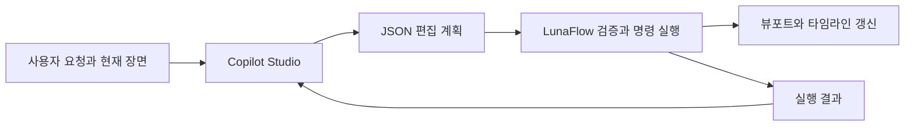

# LunaFlow용 Copilot Studio 에이전트 만들기

공식 문서 확인: 2026-10-27. 대상은 VFX와 캐릭터 애니메이션을 함께 편집하는 에이전트다.

## 현재 선택한 경로: 새 환경 + GPT-6 Astra

사용자는 새 환경의 `LunaFlow Director`와 GPT-6 Astra를 사용한다. 아래의 표준 환경 절차로 전환할 필요는 없다.
2026-10-19 SDK 팀의 새 안내에 따르면 최신 SDK는 사용자 로그인과 엔드포인트 검색으로 새 환경 에이전트 연결을 순차 지원한다.
일반 Learn 개요의 표준 환경 제한 문구보다 최신의 배포 안내이며, 환경별 성공 여부는 실제 접속 시험으로 확인한다.
[배포 및 SDK 설정 안내](https://github.com/microsoft/Agents-for-net/issues/1015)

제공된 연결 주소를 로컬 설정에 보관하고 SDK 1.9.205 연결 테스트를 준비했다.
같은 조직의 Entra 공용 네이티브 앱 등록과 사용자 로그인으로 실제 연결을 확인했다.
LunaFlow 오른쪽 AI 대화에서 현재 장면을 보내고 계획을 단계별로 적용하는 기능도 연결했다.
현재 SDK 요청에는 계획 출력 규격을 함께 전달하므로 `PlanLunaFlowEdit` 워크플로를 별도로 만들지 않아도 편집 계획을 받을 수 있다.
**[새 환경 연결 테스트 절차](../../agent_service/copilot_client/README.ko.md)**를 먼저 따른다.
아래 1~6절은 기존 표준 환경의 Prompt/Topics/Direct Line 구성 참고이며 현재 선택한 새 환경 UI에 그대로 적용하지 않는다.

## 먼저 만들 결과

**Copilot Studio가 편집 계획을 만들고, LunaFlow가 실제 편집과 재생을 수행한다.**
LLM이 모든 프레임의 입자 위치나 캐릭터 자세를 계속 보내는 구조가 아니다. 재생은 로컬 엔진에서 유지한다.



이 흐름은 오른쪽 Copilot 대화에 구현되어 있다. 왼쪽 VFX 프롬프트는 별도의 로컬 규칙 방식이다.
`CopilotProcess`는 SDK 프로세스와 비동기로 통신하며, `EditPlan`은 장면 지문·요청 ID·허용 명령·모든 단계를 검사한다.
완성된 계획 수신 후 로컬 편집 단계를 순서대로 실행하고 화면을 갱신한다. LLM 토큰을 받는 순간마다 불완전한 명령을 실행하는 구조는 아니다.

## 1. 에이전트 생성

1. [Copilot Studio](https://copilotstudio.microsoft.com/)에 학교 계정으로 로그인한다.
2. 학교에서 사용할 Power Platform 환경을 선택한다. 에이전트 생성과 게시 권한이 있는 환경이어야 한다.
3. 새 에이전트를 만들고 이름을 **LunaFlow Director**로 지정한다.
4. 설명에 다음을 입력한다.

```text
LunaFlow 애니메이션·VFX 편집기에서 사용자의 자연어 요청을 편집 계획으로 변환합니다.
현재 장면의 캐릭터, 뼈대, 동작, 효과 정보를 바탕으로 동작 수정과 파티클 제작을 계획합니다.
실제 작업은 LunaFlow가 실행하며, 실행 결과를 받은 뒤 다음 수정을 제안합니다.
```

이 안내는 `Overview / Topics / Tools`가 있는 **표준 에이전트** 화면 기준이다.
`빌드 / 미리 보기 / 평가 / 모니터`와 `기술 / 도구 / 지식`이 보이는 새 경험에서는 먼저 홈으로 이동한다.
홈 화면 왼쪽 사이드바 맨 아래의 `… → Open classic experience(클래식 환경 열기)`로 표준 환경에 들어가거나,
홈의 `Other ways to build(다른 빌드 방법)`에서 표준 에이전트 생성을 선택한다.
현재 만든 초안은 보관하고 표준 에이전트를 새로 만들어 이 안내를 적용할 수 있다.
[공식 환경 전환 안내](https://learn.microsoft.com/en-us/microsoft-copilot-studio/agents-experience/switch-experiences), [공식 생성 안내](https://learn.microsoft.com/en-us/microsoft-copilot-studio/fundamentals-get-started)

LunaFlow에 제안한 Direct Line 연결 기준으로는 표준 환경을 사용한다.
새 경험의 현재 채널 목록은 네이티브 앱/Direct Line을 미지원으로 표시하며, MCP·A2A 연결은 별도의 프리뷰 경로다.
[새 경험의 채널 지원 현황](https://learn.microsoft.com/en-us/microsoft-copilot-studio/agents-experience/publication-channels-overview)

## 2. 에이전트 지침 넣기

`Overview → Instructions → Edit`에서 [AgentInstructions.ko.txt](../Assets/Copilot/AgentInstructions.ko.txt)의 내용을 붙여넣는다.
이 파일은 대화 역할과 실제 실행 범위를 정한다.

지침에서 도구 이름을 적는 것만으로 도구가 생기지는 않는다. 다음 단계에서 실제 Prompt 도구를 등록한다.
[공식 지침 안내](https://learn.microsoft.com/en-us/microsoft-copilot-studio/authoring-instructions)

## 3. 편집 계획을 만드는 Prompt 도구 추가

`Agents → LunaFlow Director → Tools → Add a tool → Prompt`로 들어간다.

- 이름: **PlanLunaFlowEdit**
- 설명: **현재 장면을 확인하여 VFX 및 애니메이션 편집 요청을 순서 있는 JSON 계획으로 변환한다.**
- 텍스트 입력: **RequestText**, **SceneContext**, **PreviousResult**

[PlannerPrompt.ko.txt](../Assets/Copilot/PlannerPrompt.ko.txt)를 프롬프트 지침으로 사용한다.
프롬프트 아래에 각 입력 이름을 적고, 그 뒤에 `/` 또는 **Add content → Text**로 실제 입력 토큰을 삽입한다.
`{{RequestText}}` 같은 글자를 그냥 적어 두는 대신, Prompt builder에서 생성한 입력 토큰을 사용한다.

`SceneContext`에는 선택된 동작 ID와 길이, 사용할 수 있는 뼈·효과·기존 동작·명령 목록을 넣는다.
처음 테스트할 때는 아래 예제 맥락을 수동 입력한다. 실제 연결 시에는 프로그램이 현재 장면에서 구성한다.

```json
{
  "requestId": "test-request-1",
  "sessionId": "test-session-1",
  "selectedClip": {"id": "clip-a", "name": "Wave", "duration": 3.0, "revision": 0},
  "selectedBone": {"id": "bone-hand", "name": "RightHand"},
  "availableMotionPresets": ["wave", "idle", "walk_in_place"],
  "allowedOperations": ["duplicate_motion", "retime_motion", "set_bone_key", "create_particles", "update_particles", "attach_effect", "preview_motion"]
}
```

이 맥락의 ID는 Prompt builder 테스트용이다. 실제 캐릭터의 뼈 경로나 실제 요청 ID로 간주하지 않는다.

`PreviousResult`는 첫 요청에서 `없음`으로 입력한다. 후속 수정에서는 실제 실행 결과와 현재 수치를 전달한다.
[공식 Prompt 도구 생성 안내](https://learn.microsoft.com/en-us/microsoft-copilot-studio/create-custom-prompt)

## 4. JSON 출력 형태 고정

Prompt builder의 **Output을 JSON**으로 바꾸고 출력 설정에서 [PlanOutput.example.json](../Assets/Copilot/PlanOutput.example.json)을 예시로 지정한다.
테스트 후 **Save custom**으로 저장한다. 이 예시는 현재 C++ 계획 실행기가 읽는 필드 구조와 같다.

`steps`는 이름 있는 필드를 가진 객체 목록이다. `argumentsJson`은 각 명령의 인자를 담는 JSON 문자열이다.
프로그램 쪽에서 바깥 계획과 내부 인자를 각각 검증한다. 프롬프트 출력의 모양을 고정해도 뼈 ID·명령·수치가 항상 올바르다는 뜻은 아니다.

Microsoft의 JSON 출력 기능은 사용자 지정 예시를 저장해 출력 형태를 고정할 수 있다.
필드 이름이 없는 단순 배열에는 제한이 있으므로 이 예시처럼 이름 있는 객체를 사용한다.
[공식 JSON 출력 안내](https://learn.microsoft.com/en-us/microsoft-copilot-studio/process-responses-json-output)

## 5. 토픽에 연결하고 테스트

1. `Topics`에서 빈 토픽을 만든다. 이름은 **LunaFlowEdit**로 지정한다.
2. 이 토픽이 애니메이션·VFX 생성과 수정을 처리한다는 설명을 넣는다. 예제 표현은 `LunaFlow 편집`, `파티클 만들어 줘`, `동작을 빠르게 바꿔 줘`로 시작한다.
3. `Add a tool`에서 **PlanLunaFlowEdit**를 추가한다.
4. 도구 입력을 사용자 요청과 장면 맥락 변수에 연결하고, JSON 결과를 토픽 변수에 보관한다.
5. 앱에 반환할 메시지는 도구의 JSON 결과를 그대로 전달하도록 구성한다. 레코드 값이면 먼저 Power Fx의 `JSON(...)`으로 문자열화한 변수를 만들어 메시지에 넣는다. 출력 변수 이름은 도구에서 실제로 보이는 필드를 선택한다.
6. 일반 설명 문장과 기계가 읽는 계획을 구별한다. 최종 API 응답에 설명이 섞여도 프로그램이 계획 형식만 선택하도록 수신 처리를 구현한다.

메시지 노드는 변수를 출력할 수 있고 Power Fx의 JSON 함수는 레코드를 JSON 문자열로 바꿀 수 있다.
[메시지와 변수](https://learn.microsoft.com/en-us/microsoft-copilot-studio/authoring-send-message), [JSON 함수](https://learn.microsoft.com/en-us/power-platform/power-fx/reference/function-json)

처음에는 다음 테스트부터 통과시키면 된다.

| 요청 | 확인할 결과 |
|---|---|
| 선택한 인사 동작을 두 배 빠르게 해 줘 | 길이 3초를 기준으로 1.5초로 변경하는 계획 |
| 현재 동작을 복사해서 느린 버전으로 만들어 줘 | 원본을 보존하는 복제 후 길이 변경 계획 |
| 오른손에 파란 불꽃을 붙여 줘 | 선택한 뼈에 연결할 파티클 생성 계획 |
| 그 불꽃은 작게 하고 입자 수만 두 배로 해 줘 | 새 효과를 무조건 추가하지 않고 기존 효과 수정 계획 |
| 준비된 인사 동작에 손끝 마법을 붙여 재생해 줘 | 동작과 VFX를 함께 다루는 순서 있는 계획 |
| 없는 뼈에 효과를 붙여 줘 | ID를 만들어 내지 않고 필요한 정보 질문 |

## 6. 게시와 앱 연결 정보 확보

테스트를 통과하면 **Publish**로 게시한다. 수정한 뒤에는 다시 게시해야 앱에서 새 버전을 사용할 수 있다.
학교 계정의 인증·채널 정책을 유지하고, 인증은 해당 학교 환경에서 허용한 방식으로 구성한다.
기본 Microsoft 인증을 사용하는 것과 외부 데스크톱 앱에서 인증하는 방식은 구분해서 설정해야 한다.
[공식 게시·인증 설명](https://learn.microsoft.com/en-us/microsoft-copilot-studio/publication-fundamentals-publish-channels)

현재 C++ 프로그램과 연결할 때 제안하는 경로는 **Direct Line**이다. 게시한 에이전트에서 `Channels → Mobile app → Token Endpoint`를 확인한다.
이 이름이 Mobile app이어도 Microsoft는 네이티브·사용자 지정 앱 연결에 같은 절차를 안내한다.
학교 환경에서 채널을 사용할 수 없다면 관리자의 허용 여부나 인증 방식부터 확인한다.

앱 연결 단계에 필요한 것은 게시된 에이전트의 연결 정보와 인증 방식이다. 비밀 키를 채팅·저장소에 붙여넣는 방식으로 진행하지 않는다.
직접 연결 대신 Microsoft 365 Agents SDK의 .NET/Python 클라이언트를 중간 서비스로 두는 선택지도 있다.
[공식 Direct Line 연결 안내](https://learn.microsoft.com/en-us/microsoft-copilot-studio/publication-connect-bot-to-custom-application), [SDK 연결 안내](https://learn.microsoft.com/en-us/microsoft-copilot-studio/publication-integrate-web-or-native-app-m365-agents-sdk)

## 7. 프로그램에서 실시간으로 작업이 보이는 방식

아래 1~5는 구현되어 있다. 6의 실행 결과를 바탕으로 AI가 자동 재계획하는 반복 제어는 후속 확장이다.

1. UI를 멈추지 않는 작업 스레드에서 요청을 전송한다.
2. 응답에서 완성된 JSON 계획을 추출하고 세션·대상 ID·허용 명령·수치 범위를 검증한다.
3. 실행할 단계 목록을 화면에 표시한다.
4. UI 스레드에서 명령을 순서대로 실행하며 뷰포트, 선택한 뼈, 타임라인을 갱신한다.
5. 실제 성공한 단계만 완료로 표시한다. 취소와 작업 묶음 되돌리기를 제공한다.
6. 실행 결과를 Copilot Studio에 보내 다음 수정 요청의 맥락으로 사용한다.

현재 버전은 **한 번 받은 계획을 순서대로 실행하는 방식**이다. 후속 사용자 요청에는 새 장면 상태를 전달한다.
다음 버전에서는 **각 실행 결과를 받은 AI가 다음 단계를 결정하는 방식**으로 확장한다.
대화 글자가 스트리밍되는 것과 편집 명령이 단계별로 실행되는 것은 별개다.

## 8. 애니메이션 생성 범위

VFX뿐 아니라 **애니메이션 동작 생성·수정**을 같은 에이전트에서 다룬다.

- 첫 구현 범위: 기존 동작 복제·길이 변경·반복·특정 뼈 키프레임 수정·준비된 동작을 이용한 새 클립 구성.
- 확장 범위: 빈 클립에서 인사·호흡처럼 제한된 동작을 만드는 로컬 생성 도구.
- 별도 품질 검증이 필요한 범위: 자연스러운 전신 걷기·달리기·점프·전투 동작. 전용 모션 생성 도구, IK·리타기팅과 접지 처리가 필요할 수 있다.

LLM이 뼈 키를 숫자로 내놓을 수 있다는 사실과, 그 결과가 자연스러운 전신 동작이라는 평가는 다르다.
대회 첫 시연은 **인사 동작 변형 + 손끝 파티클 + 실시간 수정 + Unity 내보내기**처럼 끝까지 검증할 수 있는 작업으로 잡는 것이 현실적이다.

## 9. LunaFlow가 사용하는 에이전트 3개

| 에이전트 | 쓰는 곳 | 응답 | 설정 파일 | 만드는 법 |
|---|---|---|---|---|
| 애니메이션 (`LunaFlow Director`) | 오른쪽 AI 대화 | 편집 계획 JSON | `agent_service/copilot_client/settings.local.json` | 이 문서와 [연결 테스트](../../agent_service/copilot_client/README.ko.md) |
| VFX 전용 | VFX 탭의 VFX AI (Copilot 모드) | 파티클 명령만 허용된 편집 계획 JSON | `LunaFlow-VFXAgent/settings.local.json` | [VFX 에이전트 설정](../../LunaFlow-VFXAgent/SETUP.ko.md) |
| 사용 도우미 (`LunaFlow Helper`) | LunaFlow 도우미 창 (Shift+F1, Copilot 모드) | 사용법 텍스트 답변, 장면 편집 없음 | `LunaFlow-HelpBot/settings.local.json` | [도우미 에이전트 설정](../../LunaFlow-HelpBot/SETUP.ko.md) |

세 에이전트는 설정과 대화 기록이 분리되어 있다. 도우미는 애니메이션 에이전트와 같은 Microsoft 로그인 캐시를 쓰므로 추가 로그인이 거의 없고,
설정이 없어도 내장 설명서로 바로 답한다. 문장이 각 JSON으로 바뀌는 과정은 [문장 → JSON 변환 구조](Sentence_to_JSON.ko.md)에 정리했다.
